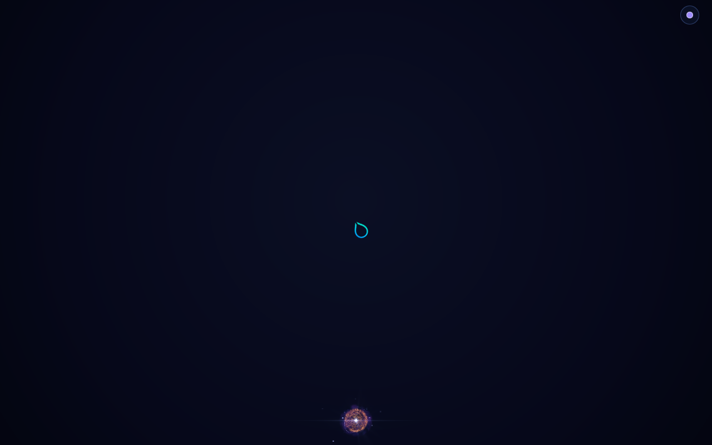

# Installing NexusOS (alpha)

NexusOS is an alpha. Install it on a spare computer or a virtual machine,
not on the machine you rely on. The installer either erases the whole disk you
pick or, beside Windows, uses only free space you have made there; back up
anything you care about first either way.

## What you need

- A 64-bit Intel or AMD computer that boots with **UEFI**. Legacy/CSM boot is not supported.
- At least 8 GB of RAM and a 64 GB disk. A local model also needs 6 GB or more of free disk space. For fast answers, an NVIDIA or AMD graphics card with 8 GB of video memory or more.
- A USB stick of 8 GB or more, or 16 GB if the image carries the local model (step 1). Writing the image erases the stick.
- No internet connection is needed to install: everything is on the stick. Without the model on the stick, the installed system downloads it once it is online.

## 1. Build the image

On any Linux machine with Nix installed and flakes turned on:

```sh
git clone https://github.com/TheMatthewWalker/NexusOS
cd NexusOS
nix run .#lock-model                 # optional: the AI model for computers with a graphics card (about 5 GB)
nix run .#lock-model -- qwen3:4b     # optional: the one for computers without (about 2.5 GB)
nix build .#iso
ls result/iso/            # nexusos-26.05-live-x86_64-linux.iso
```

The build takes a while the first time; most of it is downloaded from the NixOS cache.

`nix run .#lock-model` pins a model by writing `nix/models/<name>-<tag>.json` (for example `qwen3-8b.json`): the list of the model's files with their SHA-256 checksums, from the Ollama registry. The image build then downloads every pinned model and Nix checks each file against that list. Commit the files to keep them. The installer copies only the model it chose for the computer (see "Hardware" below); a model that is not on the image downloads after installation, once the computer is online.

## 2. Write it to a USB stick

Find the stick's device name with `lsblk`. It is usually `/dev/sdX`; check the size to be sure. Then:

```sh
sudo dd if=result/iso/nexusos-*.iso of=/dev/sdX bs=4M status=progress conv=fsync
```

On Windows or macOS, a tool such as balenaEtcher or Rufus (in "DD image" mode) does the same.

## 3. Try it live

Boot the computer from the stick (usually F12, F11, F8 or Esc during start-up opens the boot menu). Choose **NexusOS live**. If the screen stays black on a computer with an NVIDIA card, restart and choose **NexusOS live (NVIDIA)** instead.

The live desktop starts by itself and opens the **Install NexusOS** window. Behind it, the live screen has **Install NexusOS** (opens the window again), **Connect to Wi-Fi**, Restart, Shut down and, for advanced use only, **Install in a terminal (advanced)** (the text installer, `nexus-install`). Everything can be done in the window: no typing in a terminal is needed.

The live session is only for installing: Nexus, apps and the Welcome setup start once NexusOS is installed. Nothing in it is kept.

## 4. Install

1. Optional: connect to the internet with **Connect to Wi-Fi** (or a cable, or your phone's USB tethering). Online, the install can take a little less time; it does not need it.
2. In the **Install NexusOS** window:
   - **Welcome**: it looks at the computer's disks and hardware (nothing changes yet).
   - **Disk**: the disks, with their models and sizes (the USB stick is greyed out). Choose one, then **Install alongside Windows** (if the disk allows it, see below) or **Erase this disk**.
   - **You**: your name, a login name (suggested from your name), your password twice (at least 10 characters: it logs you in, approves system changes and unlocks the disk) and the computer's name.
   - **Time zone**: the detected one is chosen; type a city to change it.
   - **Summary**: the disk and what happens to it, encryption (on unless you untick it), and what the hardware scan found (Processor, Graphics, Local AI). Press **Install**, or **Erase and install**.
   - **Install**: each step as it happens. If something fails, the window shows the installer's own message, the last lines of its log and the log's path (`/tmp/nexus-install.log`); **Try again** or go back and change something.
   - **Done**: press **Restart now**, and remove the stick when the screen goes dark.

   It takes 5–30 minutes, depending on your disk. The installed system keeps the log in `/var/log/nexus-install.log`.

In a terminal instead (**Install in a terminal**, or `sudo nexus-install`), the same questions are asked in text, and you type the disk name to confirm. Every question has a flag (`nexus-install --help`), for example:

```sh
sudo nexus-install --disk /dev/nvme0n1 --alongside --user ada --full-name "Ada Lovelace" --timezone Europe/London --keyboard gb
```

### Replacing a partition

On the **Disk** step, **Replace a partition** lists the chosen disk's partitions with what is on each (Windows, Linux, an earlier NexusOS, shared files) and its size. Choose one and only that partition is deleted; NexusOS goes in its place and shares the disk's start-up (EFI) partition, as when installing alongside Windows. The rest of the disk is not changed. Partitions that cannot be replaced say why: the start-up and recovery partitions, anything in use, anything under 32 GB, and Windows itself (C:). To replace Windows, erase the disk instead. An NTFS partition the installer cannot look inside, often because of Windows' Fast startup, is not offered either. In a terminal: `sudo nexus-install --partition /dev/nvme0n1p5`.

### Keyboard

The **Keyboard** step comes before you choose your password, with the layout guessed from the time zone (a UK time zone guesses English (UK)). Choosing a layout switches the keyboard straight away, so the password is typed with it. The same layout is then used everywhere on the installed system: the prompt that unlocks the disk at start-up, the login screen, the desktop and the text consoles. Type a few of `@ " # £ \ |` in the box on that page to check them. 23 Latin layouts are offered (`nix/installer/keyboards.json`); to change it later, set `nexusos.keyboard.layout = "de";` in `/etc/nixos/local.nix` (a system change).

### Beside Windows (dual boot)

NexusOS can go into free space on a Windows disk, keeping Windows. It never shrinks or moves a partition: make the room in Windows first.

1. In Windows, back up, then open **Disk Management** (right-click Start), right-click the Windows (C:) partition, choose **Shrink volume**, and shrink it by at least 32 GB (64 GB or more is better). Leave the new space unallocated.
2. If Windows uses **BitLocker**, have your recovery key to hand (aka.ms/myrecoverykey): Windows may ask for it once after NexusOS adds its boot menu. Turning off Windows' Fast startup (Control Panel, Power Options) is a good idea too.
3. Boot the stick and choose **Install alongside Windows** on the Disk step.

The installer adds one encrypted partition in the largest free space and reuses Windows' EFI system partition without formatting it. That partition needs at least 200 MB free for NexusOS's start-up files; if it has less (Windows often makes it 100 MB), the installer says so and stops. NexusOS's start-up menu (systemd-boot) finds Windows Boot Manager by itself, so both appear at start-up. NexusOS keeps the clock in local time, as Windows does, and keeps only three older start-up entries on the shared partition.

The installer refuses, and says why, when: there is no free space (or less than 32 GB), the disk uses the old MBR layout (Windows started in legacy BIOS mode), the disk has no EFI system partition or more than one, the EFI partition is too full, or the disk already has a NexusOS partition from an earlier attempt (delete it in Disk Management). If an attempt fails part-way, the partition it added is removed again.

Each start, NexusOS asks for your password twice: first on the NexusOS start-up screen, to unlock the encrypted disk (before anything else runs), then on the login screen. Press Esc on the start-up screen to see the start-up messages.

The disk is encrypted (LUKS2) so a lost or stolen computer shows nothing without the password. If you change your login password later, the disk keeps the old one until you change it too: `sudo cryptsetup luksChangeKey /dev/disk/by-label/nexusos-crypt`. To install without encryption, run `sudo nexus-install --no-encrypt`.


 If the stick carried the local model, Nexus can answer straight away. Otherwise NexusOS downloads the model in the background once it is online (about 5 GB); until then, Nexus says it is unavailable and apps work as normal.

## Wi-Fi

Open **Settings, Network**: click the Wi-Fi icon in the top bar, the Network planet in the orbital controls (bottom right), or press Super+I. With Wi-Fi on, it lists nearby networks, strongest first, with your current and saved networks at the top.

- Click a network to connect. A secured one opens a password box; press Enter or **Connect**. **Show** reveals what you typed.
- NetworkManager keeps the password, so a saved network reconnects by itself and with one click.
- Click the connected network for **Disconnect** and **Forget** (Forget deletes the saved password).
- Work or school networks that need a username or certificate are not set up from Settings yet: **Open nmtui** on the same page, or run `nmtui` in a terminal (Ctrl+Alt+T).

## Using the desktop

- **Windows** float, like on Windows or macOS: drag the title bar to move, drag an edge to resize, and use the buttons on the left of the title bar to close, minimise or maximise. A minimised window comes back from its planet around the Nexus core at the bottom. **Settings, Desktop** switches to tiling, where windows fill the screen side by side; Super+T switches a single window.
- **Settings** (Super+I) has Network, Bluetooth, Sound, Display, Power, Desktop, Privacy and AI, and About. Type in its search box to find a setting, or to ask Nexus.
- **Adding software** (Super+A, **Apps**):
  - **Get apps** installs from Flathub, just for you and with no password. Before anything is installed, it shows who publishes the app, whether Flathub has verified them, its licence, the download size and what it may reach outside its sandbox in plain words (for example "Can read and change all your files"), with a warning for wide access. `nexus apps details <id>` shows the same in a terminal.
  - **Ubuntu (apt)**: `apt install <package>` runs apt in an Ubuntu container. **Ubuntu software runs as you and can read your home folder**: the container shares it (and can see the rest of the computer's files), so it is not a sandbox. Install only software you trust there. For anything else use `apt --isolated install <package>` (or **Install isolated**): a separate container with its own home folder (`~/.local/share/nexus-apt/ubuntu-isolated-home`) that cannot see your files; it is for command-line tools (`apt --isolated run <program>`), not desktop apps.
  - Every install and removal, from Flathub or apt, is listed in **Settings, Timeline** with **Undo**: Undo removes what was installed, or reinstalls what was removed in the same place (just for you, or for everyone) and at the same version when it is still offered. Nexus can do the same when you ask it.
  - Removing a Flathub app keeps its settings and files (`~/.var/app/<id>`), so reinstalling brings them back. Apps then offers to delete them; it never does so unless you choose **Delete its data**, which cannot be undone.
- **Shortcuts**: Super+Space Nexus, Super+Return terminal, Super+E files, Super+Q close, Super+M maximise, Super+F fullscreen, Super+1 to 5 workspaces, Super+L lock.

## Teaching Nexus about you

Nexus reads a built-in guide to NexusOS with every question, plus any notes you write. Put text or Markdown files in `~/.config/nexusos/assistant/` (**Settings, Privacy and AI, Open folder**): who you are, what you use the computer for, how you like answers. They are read each time, so a change takes effect on the next question. Nothing is uploaded or used to retrain the model.

Nexus can also do things for you, but only from a fixed list of actions, never by running commands. Looking something up (your computer's state, its health, your files, your apps, today's activity) happens at once. Anything that changes something (opening an app, night light or volume, installing an app from Flathub, an automation, a picture) appears under the answer as a card saying what it will do: nothing happens until you press **Do it**, and changes to your settings can be undone in **Settings, Timeline**. Changes to the system itself (software for every account, services) are sent to Guardian with **Review the change**, and happen only once you approve them there. A cloud model, if you turn one on, is never given your files or your activity.

## Hardware

The installer looks at the computer and sets it up; you do not pick drivers. The summary before the install shows what it found:

```
  Processor: Intel(R) Core(TM) i5-1235U, 16 GB memory, laptop
  Graphics:  Intel Iris Xe Graphics (built-in drivers)
  Local AI:  qwen3:4b, on the processor, from the USB stick
```

| Found | What NexusOS does |
|---|---|
| Intel or AMD built-in graphics | The kernel and Mesa drivers, with video decoding (VA-API) for both makers |
| Intel laptop | Intel's thermal daemon, so the processor does not throttle hard |
| NVIDIA card | Its driver, below |
| AMD card with 6 GB of its own memory or more | The local model runs on it (Vulkan) |
| A graphics card for AI (NVIDIA, or AMD as above) | Local model `qwen3:8b` |
| No such card, 8 GB of memory or more | `qwen3:4b` on the processor: about twice as fast there as the 8B model |
| Less than 8 GB of memory | `qwen3:1.7b` |
| 16 GB of memory or more | The large model as well (see "The large model" below) |
| No graphics card for AI and less than 16 GB of memory | Image generation is off (it needs about 8 GB of memory and a 7 GB download) |

What it found is in `/etc/nixos/local.nix` under `nexusos.hardware`. To use another model, run `sudo nexus-install --model qwen3:8b`, or later set `services.nexus-core.ollamaModel` in `local.nix` and rebuild.

## The large model

On a computer with 16 GB of memory, NexusOS also downloads a much bigger model once it is online: by default `DavidAU/OpenAi-GPT-oss-20b-HERETIC-uncensored-NEO-Imatrix-gguf` at `Q8_0`, a 21-billion-parameter *mixture-of-experts* model. Such a model is split into many "experts" and uses only a few of them for each word (about 3.6 billion parameters' worth), so it does the work of a small model while knowing as much as a big one. NexusOS runs it with llama.cpp, which keeps the experts in ordinary memory and puts the part every word needs on the graphics card (`--n-cpu-moe`); the split is worked out from the graphics memory the computer has. Without a graphics card the whole model runs from memory on the processor.

| | |
|---|---|
| Which version | The quantisation asked for, if this computer can hold it: its memory beside the desktop (4 GB kept back) plus what a graphics card takes. If it cannot (Q8_0 may be too big for 16 GB), the biggest version in the repository that fits is downloaded instead, and Settings says which and why |
| Download | Once online, with room checked first (the file plus 2 GB), resumed if interrupted, and kept only if it matches the SHA-256 in the repository's file list |
| Using it | With a graphics card for AI, Nexus answers with it as soon as it is downloaded. Otherwise turn it on in **Settings, Privacy and AI, Large model**, or ask Nexus ("use the large model") |
| Memory | One model is in memory at a time. Before the large model loads, NexusOS checks there is enough free memory; if not, it says how much is short and the standard model answers. The same happens if it fails to start |

To choose another model or version, set in `/etc/nixos/local.nix` (a system change):

```nix
nexusos.largeModel.repo = "unsloth/gpt-oss-20b-GGUF";
nexusos.largeModel.quant = "Q4_K_M";
nexusos.largeModel.exact = true;   # never a smaller version than the one named
```

`nexusos.largeModel.enable = false;` leaves it out.

## The very large model

[colibri](https://github.com/JustVugg/colibri) goes further: it runs mixture-of-experts models bigger than the computer's memory. The part of the model every word uses stays in memory and the experts are read from the disk when the model asks for them, so the disk's speed sets how fast it answers (a fast NVMe drive helps most). Any graphics processor, built-in ones included, can hold part of it through Vulkan.

Nothing is downloaded until you turn it on in **Settings, Privacy and AI, Very large model** (or ask Nexus, "use the very large model"). The download goes into your own folder (`~/.local/share/nexusos/colibri`), resumes after a restart, and every file is checked against the repository's SHA-256. Only the models this computer can hold are offered:

| Model | Download | Memory | Speed on a laptop processor |
|---|---|---|---|
| Qwen3.6-35B-A3B (default with 10 GB or more): everyday questions, thinking and tools | 23 GB | 10 GB at least, 20 GB to keep every expert in memory | about 6 words a second, 10 with a built-in GPU (colibri's measurements) |
| Qwen3-Coder-30B-A3B: code, with tools | 19 GB | 8 GB at least | about 5 to 9 words a second |
| DeepSeek V4 Flash (284B) | 167 GB | 16 GB at least | about one word a second |
| GLM-5.2 (744B) | 429 GB | 16 GB at least | very slow without much more memory |

It needs a processor with AVX2 (Intel from 2013, AMD from 2015); Settings says so on older ones. Once downloaded, switch it on with **Use the very large model**: the other models leave memory first, and if it cannot start, the standard model answers and Settings says why. **Remove** deletes the download.

`nexusos.colibri.enable = false;` in `/etc/nixos/local.nix` leaves the engine out; `nexusos.colibri.model` sets which model is offered first. colibri is © Vincenzo Fornaro, Apache License 2.0; its licence and notices are in `/etc/nexusos/licences/colibri` ([third-party notices](../THIRD_PARTY_NOTICES.md)).

## NVIDIA graphics

The installer finds an NVIDIA card and sets up its driver; the summary before the install shows what it found ("Graphics: …"). You do not need to do anything. It sets:

| Computer | What NexusOS uses |
|---|---|
| Laptop with an Intel or AMD built-in GPU as well | PRIME offload: the desktop runs on the built-in GPU, which saves battery. Run an app on the NVIDIA GPU with `nvidia-offload <app>` |
| NVIDIA card only (most desktops, or a laptop with its MUX switch set to the dedicated GPU) | The NVIDIA card runs the desktop |
| GTX 900 or 10 series (older than Turing) | The 580 driver series with NVIDIA's closed kernel modules, the last that supports these cards |

The local model runs on the NVIDIA GPU through Ollama's Vulkan backend. The settings are in `/etc/nixos/local.nix` under `nexusos.nvidia`; to switch the model to CUDA (often faster, but it compiles Ollama on your computer, which takes a long time), add `nexusos.nvidia.ollamaBackend = "cuda";` and rebuild. To install without the NVIDIA driver, run `sudo nexus-install --no-nvidia`.

Building the image (step 1) downloads NVIDIA's driver from nvidia.com and builds it, so the install does not have to.

## In a virtual machine

Windows keeps the Super (Windows) key for itself, so Super shortcuts do not reach NexusOS in a VM or remote desktop on Windows. Open a terminal with **Ctrl+Alt+T** instead, and open Nexus by clicking the core at the bottom of the screen.

## What the installer does

| Step | Detail |
|---|---|
| Disk | Erasing: a GPT table with a 1 GiB EFI system partition (`BOOT`) and an ext4 root (`nexusos`) inside LUKS2 encryption (`nexusos-crypt`), unlocked with your password. Alongside: only that root partition, in the free space, with the existing EFI partition reused |
| Source | The NexusOS source from the stick is copied to `/etc/nixos/nexusos` |
| Configuration | `/etc/nixos/flake.nix` imports NexusOS. `/etc/nixos/local.nix` holds your user name, computer name and time zone. `/etc/nixos/hardware-configuration.nix` is generated for your hardware |
| Boot loader | systemd-boot, keeping the last 20 system versions. Pick an older one at start-up if an update goes wrong |

## Updates

Guardian looks for updates weekly and prepares them in the background: security updates for everything from NixOS, and, on a computer installed from a release image, new NexusOS releases. When one is ready, the System change window asks for your password; it is used from the next restart, and if that start fails, the computer goes back by itself. Ask Nexus "check for updates" to look now.

## Changing the system afterwards

Edit `/etc/nixos/local.nix` (for example `nexusos.autologin = true;`), then run:

```sh
sudo nixos-rebuild switch --flake /etc/nixos#nexus
```

The options are documented in `nix/profiles/nexusos.nix` and `nix/modules/desktop.nix` (under `/etc/nixos/nexusos`).

### Updates

Flathub apps update by themselves every day. The system itself (the kernel, Firefox, Chromium, the desktop) gets security updates through Guardian: once a week, when the computer is online and has at least 10 GiB free, it looks for newer NixOS 26.05 packages, builds and tests them on this computer, and the top bar says "Security updates are ready". The System change window lists what changes (for example Linux 6.18.56 → 6.18.60); approve with your password and restart. The update is tried once at that restart, and if the computer does not start properly it goes back to the previous version by itself. Ask Nexus "check for updates" to look now.

Only after a confirmed restart is `/etc/nixos/flake.lock` updated, so `nixos-rebuild` afterwards builds on the new packages. NexusOS's own files under `/etc/nixos/nexusos` are not changed by updates. To turn the weekly check off, set `nexusos.updates.enable = false;` in `local.nix`.

## Not in this alpha

- Choosing partitions by hand, or shrinking a partition to make room (do that in Windows).
- A Files app of its own: Thunar is the file manager. System-wide settings (software, services) are changed in `local.nix`.

## How the installer is tested

`nix build .#checks.x86_64-linux.nexus-installer` runs the whole install in a UEFI virtual machine without network access. The test:
1. installs onto a blank disk;
2. boots that disk;
3. checks it is NexusOS with the right computer name;
4. checks the user exists with their password set;
5. checks the desktop, Core and Ollama are installed;
6. checks the machine can evaluate its own configuration.
