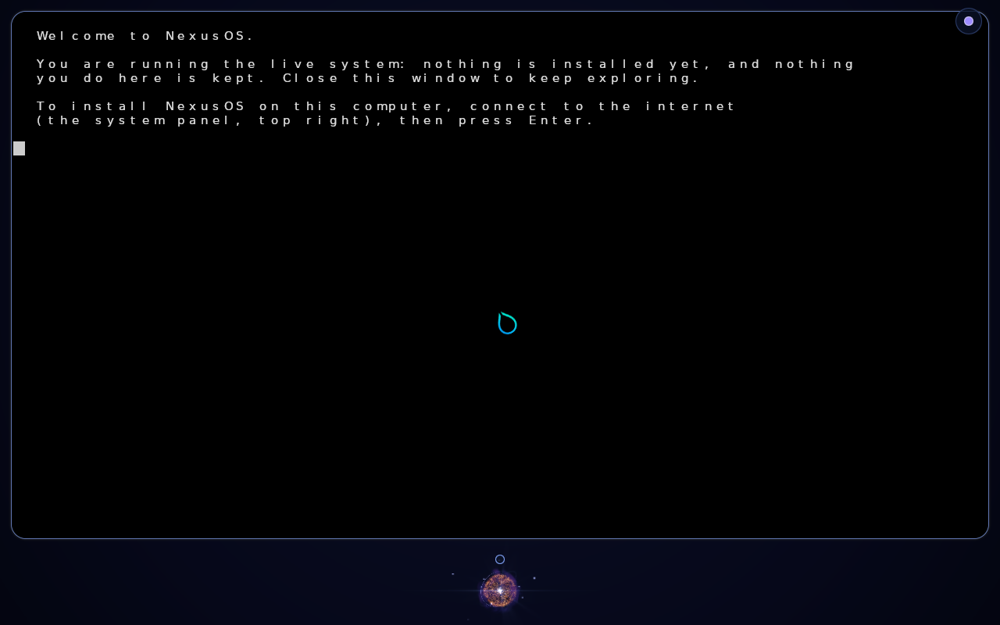

# Installing NexusOS (alpha)

NexusOS is an alpha. Install it on a spare computer or a virtual machine,
not on the machine you rely on: the installer erases the whole disk you pick.

## What you need

- A 64-bit Intel or AMD computer that boots with **UEFI**. Legacy/CSM boot is not supported.
- At least 8 GB of RAM and a 64 GB disk. A local model also needs 4 GB or more of free disk space.
- A USB stick of 8 GB or more. Writing the image erases the stick.
- An internet connection during the install. Most of NexusOS is already on the image, but the parts built for your computer's hardware, and the local model, are downloaded.

## 1. Build the image

On any Linux machine with Nix installed and flakes turned on:

```sh
git clone https://github.com/TheMatthewWalker/NexusOS
cd NexusOS
nix build .#iso
ls result/iso/            # nexusos-26.05-live-x86_64-linux.iso
```

The build takes a while the first time; most of it is downloaded from the NixOS cache.

## 2. Write it to a USB stick

Find the stick's device name with `lsblk`. It is usually `/dev/sdX`; check the size to be sure. Then:

```sh
sudo dd if=result/iso/nexusos-*.iso of=/dev/sdX bs=4M status=progress conv=fsync
```

On Windows or macOS, a tool such as balenaEtcher or Rufus (in "DD image" mode) does the same.

## 3. Try it live

Boot the computer from the stick (usually F12, F11, F8 or Esc during start-up opens the boot menu). Choose **NexusOS live**.

The live desktop starts by itself, with a terminal called **Install NexusOS**:



- Close that terminal to look around. Nothing in the live session is kept.
- Super+Space opens Nexus.
- The local model is not on the stick, so Nexus answers only after installation. Everything else works.

## 4. Install

1. Connect to the internet: open the system panel (top right) and turn on Wi-Fi, or plug in a cable.
2. In the **Install NexusOS** terminal, press Enter. If you closed it, press Super+Return for a new terminal and run `sudo nexus-install`.
3. The installer asks for:
   - the disk to install to (it lists the disks with their sizes and models);
   - your login name, full name and password;
   - then you type the disk name again to confirm it may be erased.

   It then partitions the disk, writes the configuration and installs NexusOS. That takes 5–30 minutes, depending on your connection and disk.
4. When it says **NexusOS is installed**, remove the stick and restart.

On the first start, NexusOS asks for your password.


 It then downloads the default local model in the background (a few GB). Until the model is there, Nexus says it is unavailable and apps work as normal.

## What the installer does

| Step | Detail |
|---|---|
| Disk | A GPT table with a 1 GiB EFI system partition (`BOOT`) and an ext4 root (`nexusos`) |
| Source | The NexusOS source from the stick is copied to `/etc/nixos/nexusos` |
| Configuration | `/etc/nixos/flake.nix` imports NexusOS. `/etc/nixos/local.nix` holds your user name, computer name and time zone. `/etc/nixos/hardware-configuration.nix` is generated for your hardware |
| Boot loader | systemd-boot, keeping the last 20 system versions. Pick an older one at start-up if an update goes wrong |

## Changing the system afterwards

Edit `/etc/nixos/local.nix` (for example `nexusos.autologin = true;`), then run:

```sh
sudo nixos-rebuild switch --flake /etc/nixos#nexus
```

The options are documented in `nix/profiles/nexusos.nix` and `nix/modules/desktop.nix` (under `/etc/nixos/nexusos`).

## Not in this alpha

- Disk encryption, dual boot, and choosing partitions by hand. The installer always uses a whole disk.
- A graphical installer. The installer runs in a terminal.
- Guardian (AI-proposed system changes) is not switched on in installed systems yet. It needs a builder signing key to be set up on each machine.
- Settings and Files apps of its own. Thunar is the file manager, and settings are changed in `local.nix`.
- NVIDIA graphics need extra configuration (`hardware.nvidia`), which the installer does not add.

## How the installer is tested

`nix build .#checks.x86_64-linux.nexus-installer` runs the whole install in a UEFI virtual machine without network access. The test:
1. installs onto a blank disk;
2. boots that disk;
3. checks it is NexusOS with the right computer name;
4. checks the user exists with their password set;
5. checks the desktop, Core and Ollama are installed;
6. checks the machine can evaluate its own configuration.
