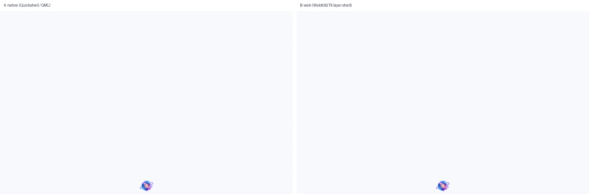
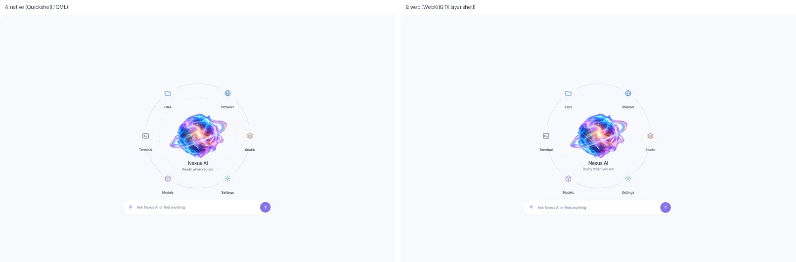
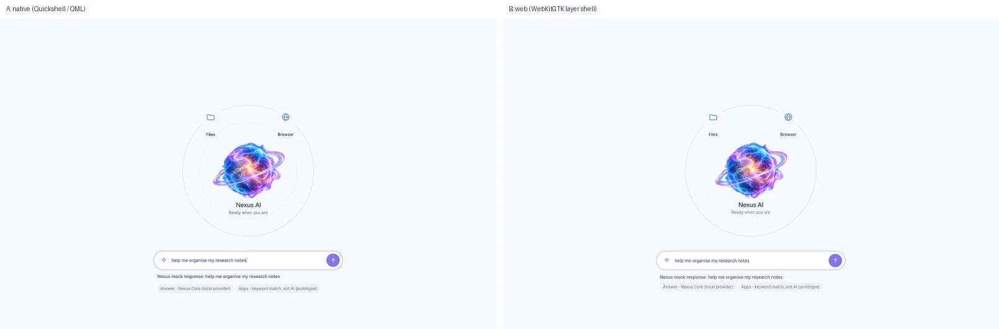
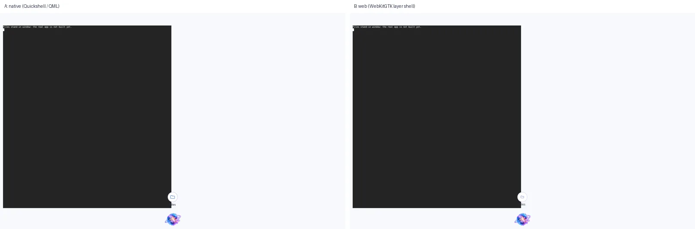

# SpaceUI shell spike: native versus web

**21 Oct 2026.** This spike answered the "shell technology" decision in the
[design pack](spaceui/README.md). **Outcome (22 Oct 2026):** the owner chose
the recommended native option, Quickshell on Hyprland
([ADR-003](../adr/003-desktop-shell.md), accepted).

## What was built

Two shells were built with the same scope, the same shared code and the same
scripted test:

| | A: native | B: web |
|---|---|---|
| Stack | [Quickshell](https://quickshell.org) 0.3: QML on Qt 6, GPU scene graph | WebKitGTK 6.0 page inside a GTK 4 layer-shell window, Python host |
| Code | `spike/spaceui/native/` | `spike/spaceui/web/` |

Both shells do the following:

- **Bottom launcher.** A small plasma Nexus sits at bottom centre, with no taskbar.
- **Full core.** Clicking the launcher opens the full core, the orbit and the chat bar.
- **Apps emerge.** Clicking the core brings every app out along the curved
  emergence path. Typing an intent brings out only the matching apps, after the
  350 ms debounce.
- **Real Nexus Core answers.** Enter sends the prompt to a running Nexus Core
  through `nexus ask`. Here it answered from the mock model. The reply is
  labelled with the provider that answered, and the app suggestions are
  labelled as a keyword match rather than AI (binding rule 1).
- **App launch and snapping.** Choosing an app opens it, the compositor snaps
  it to the left tile, and Nexus collapses again. Files has no real app yet,
  so a labelled stand-in window opens instead.
- **Open apps as planets.** Each open app becomes a tiny planet orbiting the
  launcher. After the 600 ms hover delay the planets spread into a wider,
  labelled, clickable orbit. Both shells get the window list from the
  compositor's toplevel protocol, so nothing is faked.
- **Click-through.** Clicks on transparent parts of the shell reach the windows
  underneath.
- **Reduced motion.** Under reduced motion the core is a still frame and apps
  appear in place.

**Shared code** (`spike/spaceui/shared/`):

- one plasma shader body, compiled for both Qt (GLSL 440 → `.qsb`) and WebGL2;
- the emergence path, easing and slot geometry, as one ES module imported
  unchanged by both QML and the web page;
- tokens generated from `design-tokens.json`;
- a 512 px core asset downscaled with premultiplied alpha.

Because the drawing code is shared, the two shells render the same pixels.
Across the scenario the mean screenshot difference is below 1 level in 255,
and fewer than 0.5 % of pixels differ visibly (font antialiasing). Visual
fidelity therefore does not separate the two options. What separates them is
what each costs to run and to integrate.






## Results

These are medians of 3 runs per shell, plus 1 reduced-motion run each
([summary.json](spaceui/spike/summary.json)). Every run completed, and every
run passed the click-through check.

| Measure | A: native | B: web | Difference |
|---|---|---|---|
| Startup to first launcher pixel | **0.5 s** | 1.4 s | web ≈ 3× slower |
| Memory (PSS, whole process tree), launcher idle | **204 MiB** | 427 MiB | web ≈ 2.1× |
| CPU, launcher idle, core animating | **36 %** | 57 % | web ≈ 1.6× |
| CPU while responding (full core, animated) | **107 %** | 134 % | web ≈ 1.3× |
| CPU, reduced motion, idle | 0.0 % | 0.2 % | both idle properly |
| Frame rate (idle / responding) | 60 / 60 | 60 / 60 | equal |
| Shell-specific code (non-blank, non-comment lines) | **347** | 459 | plus 125 shared lines |
| Processes | 1 | 3 (UI, web, network) | |

**How to read the CPU numbers.** There is no GPU here: Mesa's llvmpipe runs
every shader on the CPU, so the absolute CPU numbers are far higher than on
real hardware. They are only valid for comparing the two shells against each
other. Memory and startup are much less affected by the missing GPU.

**Memory for a reader new to it.** PSS (proportional set size) is a fair way
to add up memory across processes. Each shared library's memory is divided
among the processes that use it, so nothing is counted twice. WebKit always
runs a separate web process and network process, and the harness counts all
of them.

## Integration: what each approach had to build

This matters more than the raw numbers, because the shell is mostly
integration work.

| Need | A: native | B: web |
|---|---|---|
| Layer-shell surface (Top layer, so it stays below lock screens) | Built into Quickshell (`PanelWindow`, `WlrLayershell`) | gtk4-layer-shell, which must be **LD_PRELOAD**ed before GTK loads. The host then has to remove it from the environment, or every app it launches inherits it (the spike hit this) |
| Click-through input region | One line: `mask: Region { item: … }` | The page reports rectangles to the host, and the host sets a cairo input region |
| Open-window list for launcher planets | Built in (`ToplevelManager`) | GTK has no API for it, so the host has to implement `wlr-foreign-toplevel-management` itself over a second Wayland connection |
| Talking to Nexus Core | `Process` in QML | A message bridge, page → host → process → page |
| Sandboxing | Not applicable | WebKit's sandbox needs user namespaces. The test container has none, so it was disabled **for the spike only**. A real install must keep it on |
| Plain-text model output | `textFormat: Text.PlainText` | `textContent`, never `innerHTML` |
| Future Hyprland features (workspaces, keybinds, IPC) | Quickshell ships a `Quickshell.Hyprland` module | Every feature needs host code first |

For each new system feature (notifications, tray, audio, Bluetooth,
network), the native route usually has a ready Quickshell module. The web
route needs a host bridge first and the UI second.

**Where the web route is stronger.**
- The design prototype is React, CSS and TypeScript, so a web shell can reuse
  more of its styling.
- Iteration in browser developer tools is quicker than restarting a shell.
- More people can write it.

These are real advantages, but they are mostly about developer convenience,
not about the product.

**Accessibility.** Both shells expose names and roles: Qt `Accessible.*`
properties in A, and ARIA plus native elements in B. Neither was tested with
a screen reader here, because none is available in the container. That check
belongs to the next step whichever option is chosen.

## Recommendation

**A: native, Quickshell on Qt 6.** It uses half the memory, starts faster
and needs less CPU. More importantly, the system integration this desktop
needs is first-class there and has to be hand-built on the web route. Since
the two render the same pixels, choosing native costs nothing in design
fidelity. Keeping the shared ES modules and shader means the prototype's
motion and geometry carry straight across.

## Limits of this spike, and what to check next

- **Compositor.** The spike ran on sway, which uses the same wlroots
  protocols, because Hyprland needs a GPU render node that the container
  lacks. Hyprland-specific behaviour must be checked in a NixOS VM test.
- **Real GPU.** Repeat the runs on your own machine to get real GPU numbers.
  Expect both shells' CPU use to drop sharply.
- **Suggestions are still keywords.** App suggestions are the prototype's
  keyword rules. The real fix is for Core to return structured, allowlisted
  suggestions.
- **Settings and windows.** The orbital settings panel, the Files and
  Settings windows, and the layout chooser were not part of the spike.

## Reproduce

```sh
dotnet publish src/NexusOS.Core -c Release -o out/core
dotnet publish src/NexusOS.Cli -c Release -o out/cli
nix develop .#spaceui-spike --command python3 scripts/spike/compare.py 3
nix develop .#spaceui-spike --command python3 -m unittest tests/spike/test_shared.py tests/spike/test_shells.py
```

[`scripts/spike/harness.py`](../../scripts/spike/harness.py) starts:

- a headless sway compositor;
- the mock model and Nexus Core;
- one persistent virtual pointer and keyboard, through
  [`vinput.py`](../../scripts/spike/vinput.py). One-shot tools create and
  destroy a device per command, and on a seat with no other devices the
  clients drop those events.

It then drives the scenario and writes screenshots and `metrics.json` to
`out/spike/<shell>/`. The end-to-end test also includes a negative control:
with the native input mask removed, the click-through check fails, as it
should.

## Update, 22 Oct 2026: the Nova core in the Quickshell shell

After you approved the Nova core and the dark theme, the native shell was moved over to both:

- `native/NovaCore.qml` draws the core with the shared shader body in `shared/nova-core.glsl`.
- Qt shader items cannot sample 3D textures, so the study's 64³ noise field is repacked as a 2D atlas. Each slice is a tile with a wrapped one-pixel border, which keeps the noise identical to the study's. A test checks the packing.
- **Launcher core.** It uses 24 samples through the gas instead of 56, and renders at 30 frames per second while it is idle and not hovered. Full rate returns as soon as you hover it or Nexus becomes active.
- **Interaction.** Dragging the core turns it, tapping it sends out a ripple, and a spoken reply drives the core's voice.
- **Dark theme.** Glass surfaces, light text and a lighter set of icons. The colours are provisional until a dark token set is agreed.

The software-rendered numbers rose a lot. Idle went from 36 % to 93 % CPU. While responding, the frame rate fell from 60 to about 9 fps, because llvmpipe now draws the full 3D core on the processor. A GPU runs this shader in a few milliseconds per frame, so the real check is to run the shell on your own hardware.
